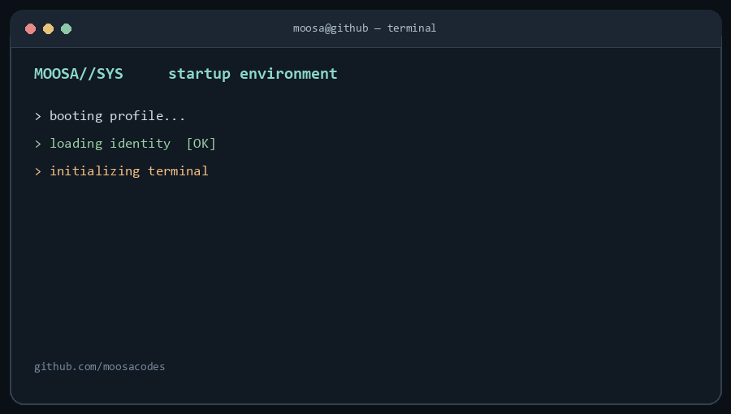

  

  <a href="https://moosaalam.dev">portfolio</a> &nbsp;·&nbsp;
  <a href="https://github.com/moosacodes?tab=repositories">projects</a> &nbsp;·&nbsp;
  <a href="https://github.com/moosacodes/Open-Role-Radar">open-role-radar</a> &nbsp;·&nbsp;
  <a href="https://github.com/moosacodes/InfraPulse">infrapulse</a> &nbsp;·&nbsp;
  <a href="https://github.com/moosacodes/Agent-Seatbelt">agent-seatbelt</a>

<!-- Terminal concept inspired by https://github.com/x0rzavi/github-readme-terminal -->
