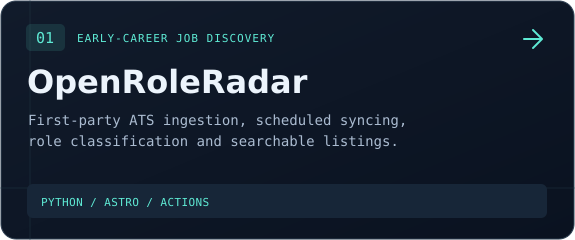
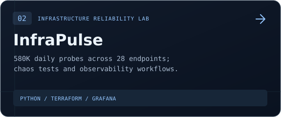
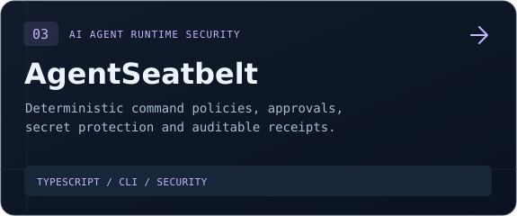
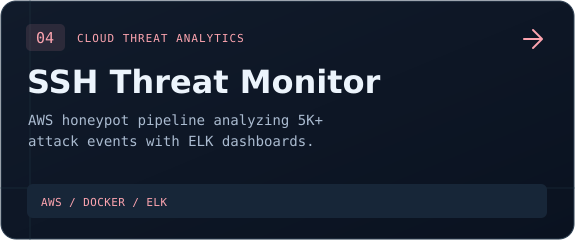
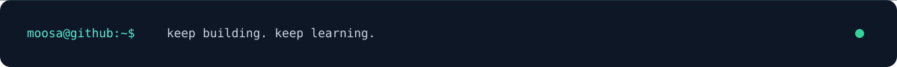

<div align="center">

<a href="https://github.com/moosacodes"></a>

<br />

[](https://github.com/moosacodes/my-portfolio)
[](https://github.com/moosacodes?tab=repositories)
[](https://moosacodes.github.io/Open-Role-Radar/)

</div>

### `> hello_world`

I'm **Moosa**, a Computer Science + Co-op student at the **University of Guelph**. I like engineering problems that span the whole stack—from a socket or shell command to cloud infrastructure, data pipelines, and the user-facing product.

I build things to understand how they actually work, and I document the trade-offs and results along the way. Currently interested in **software, cloud/platform engineering, security, and developer tooling**.

```bash
moosa@github:~$ cat current-focus.txt
> Shipping useful software, not just collecting frameworks.
> Learning deeper systems, networking, and cloud fundamentals.
> Exploring Winter 2027 co-op opportunities.
```

### `> selected_work` 

<div align="center">
<table>
<tr>
<td width="50%"><a href="https://github.com/moosacodes/Open-Role-Radar"></a></td>
<td width="50%"><a href="https://github.com/moosacodes/InfraPulse"></a></td>
</tr>
<tr>
<td width="50%"><a href="https://github.com/moosacodes/Agent-Seatbelt"></a></td>
<td width="50%"><a href="https://github.com/moosacodes/Distributed-SSH-Threat-Monitor"></a></td>
</tr>
</table>
</div>

<details>
<summary><b>More things I've built ↗</b></summary>
<br />

- **[Multithreaded HTTP Server](https://github.com/moosacodes/Multithreaded-HTTP-Server)** — HTTP/1.1 server in C with BSD sockets and a pthread thread pool.
- **[MOOSA.OS](https://github.com/moosacodes/my-portfolio)** — desktop-style Next.js portfolio with draggable windows and a terminal-like interface.
- **[Dockerized API](https://github.com/moosacodes/dockerized-api)** — FastAPI, Docker, tests, and GitHub Actions CI.

</details>

### `> stack --show`

<div align="center">


</div>

### `> activity --live`

<div align="center">

[](https://github.com/moosacodes)

<sub>Activity graph is generated by a third-party service and may occasionally be unavailable.</sub>

</div>

### `> connect`

Interested in working on real engineering problems together? Start with [my projects](https://github.com/moosacodes?tab=repositories) or explore [MOOSA.OS](https://github.com/moosacodes/my-portfolio).

<div align="center">

</div>
